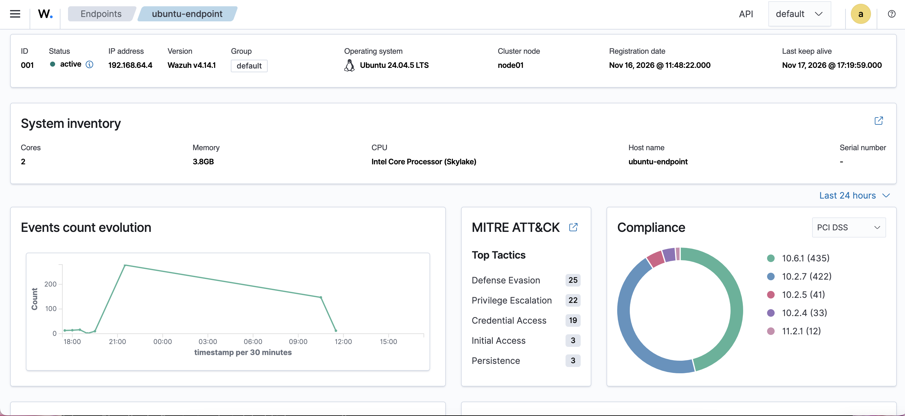
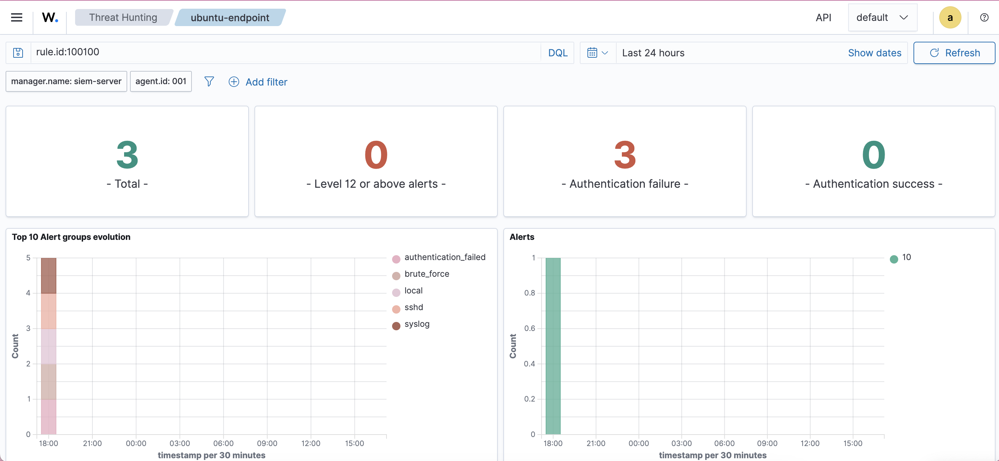
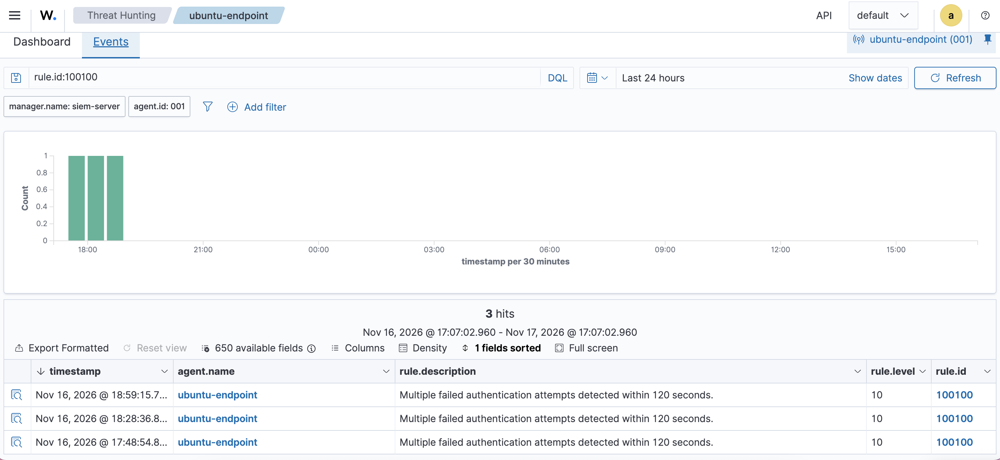
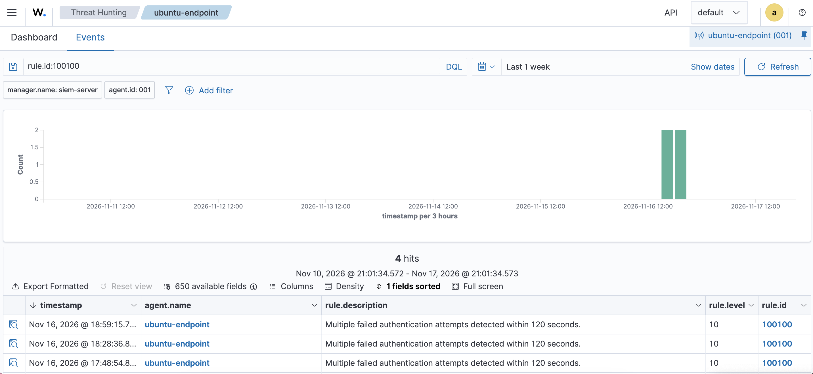
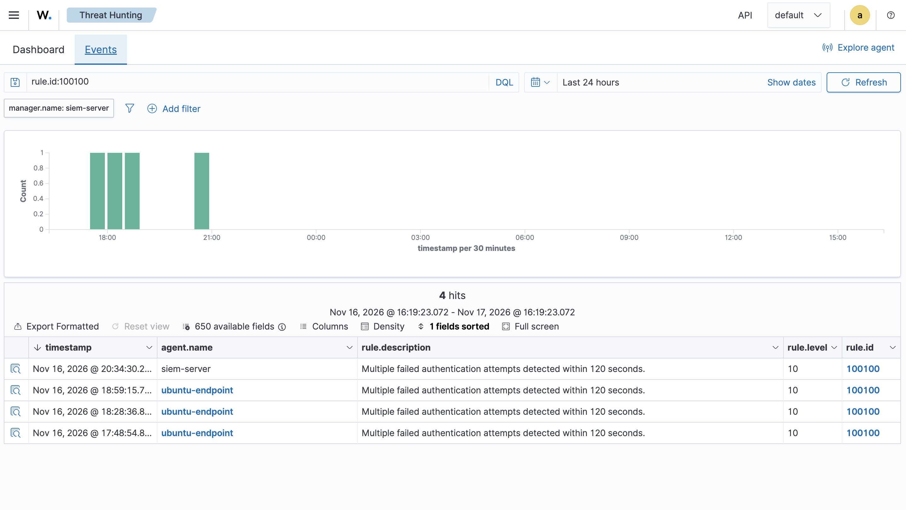

# Wazuh SSH Brute-Force Detection & Investigation

A hands-on SIEM and detection-engineering lab using Wazuh to identify repeated SSH authentication failures, validate a custom detection rule, and investigate related Linux authentication events.

> **Lab context:** The failed SSH attempts documented here were intentionally generated in a controlled environment. They are simulated test activity, not evidence of an actual external compromise.

## Objectives

- Generate controlled SSH authentication failures.
- Create and validate a custom Wazuh correlation rule.
- Inspect alert JSON and correlate events with SSH/PAM logs.
- Review authentication history and local network context.
- Document findings in a SOC-style incident report.

## Environment and tools

- Wazuh SIEM
- Ubuntu Linux endpoint
- SSH and PAM authentication logging
- `jq`, `journalctl`, `last`, `lastb`, `ss`, `ip neigh`, and `ip route`

## Custom detection rule

| Setting | Value |
|---|---|
| Rule ID | `100100` |
| Level | `10` |
| Frequency | `5` |
| Timeframe | `120` seconds |
| Parent rule | `5760` |
| Correlation | Same source IP |
| MITRE ATT&CK | `T1110` – Brute Force |

The example rule is included in [`rules/local_rules.xml`](rules/local_rules.xml). Review the parent rule and your installed Wazuh version before deploying it; test custom rules in a lab first.

## Investigation workflow

1. Generate a controlled series of failed SSH logins.
2. Inspect `/var/ossec/logs/alerts/alerts.json`.
3. Filter events by source IP and relevant rule IDs using [`queries/alert-investigation.jq`](queries/alert-investigation.jq).
4. Inspect the full alert for rule metadata, source address, destination user, and raw log.
5. Correlate alert timestamps with SSH/PAM events using `journalctl`.
6. Review login history with `last -ai` and `lastb -ai`.
7. Review local network context with `ss`, `ip neigh`, and `ip route`.
8. Record findings in the [SOC incident report](documentation/incident-report.md).

## Selected screenshots

The following screenshots provide a visual overview of the monitored endpoint, security events, authentication investigation, event timeline, and custom detection alert.

### 1. Wazuh endpoint overview



### 2. Security events dashboard



### 3. Authentication event details



### 4. SSH authentication event timeline



### 5. Custom rule 100100 alerts



See [`docs/TEST_CASES.md`](docs/TEST_CASES.md) for the documented test cases. Additional terminal and investigation evidence is stored in [`evidence/`](evidence/).

## Key finding

The custom rule generated a Level 10 alert (`100100`) describing repeated failed authentication attempts within the configured 120-second timeframe. The documented alert included source IP `192.168.64.1` and target account `analyst`. These values are specific to this lab run and should not be interpreted as evidence of a malicious external actor.

## Skills demonstrated

- SIEM alert monitoring and triage
- Custom Wazuh rule development
- Linux authentication-log analysis
- JSON parsing with `jq`
- Event correlation and investigation
- MITRE ATT&CK mapping
- Incident documentation

## Repository layout

```text
├── README.md
├── docs/
│   ├── TEST_CASES.md
│   └── 01-... through 05-... screenshot files
├── documentation/
│   └── incident-report.md
├── evidence/                 # terminal and investigation evidence images
├── queries/
│   └── alert-investigation.jq
├── reports/
├── rules/
│   └── local_rules.xml
└── scripts/
    └── analyze_ssh_logs.sh
```

## Future improvements

- Add a dashboard view of SSH authentication trends.
- Enrich alerts with asset and IP context.
- Add detection tests for additional authentication scenarios.
- Document false-positive considerations and tuning decisions.
